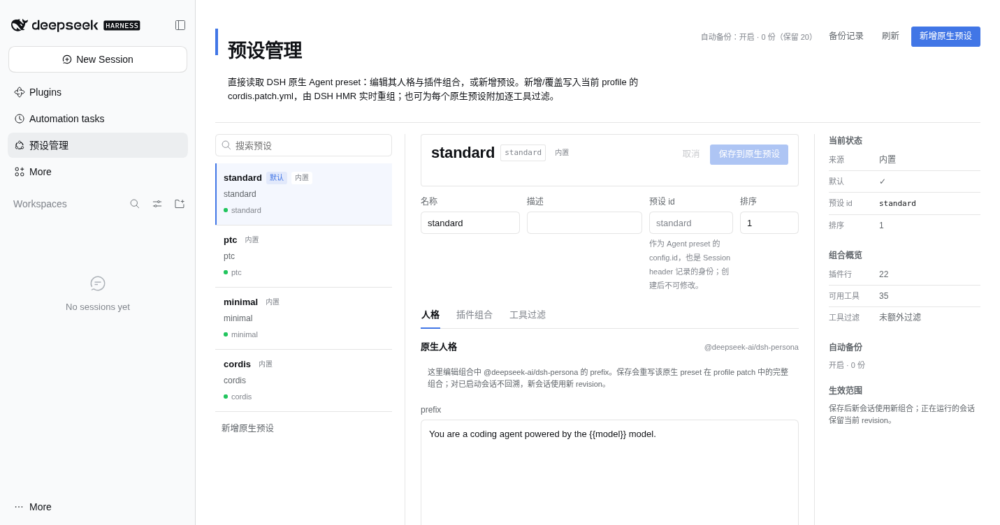
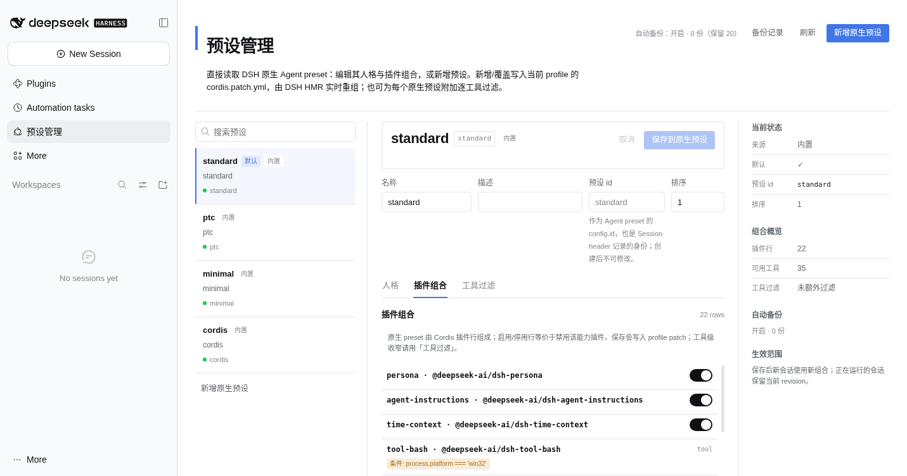
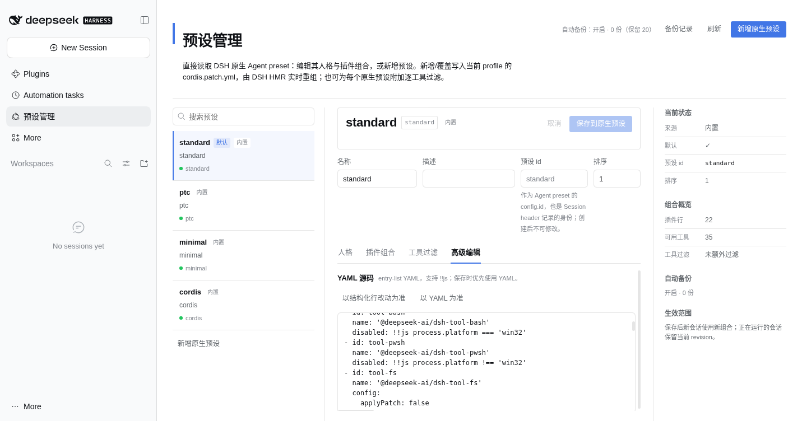
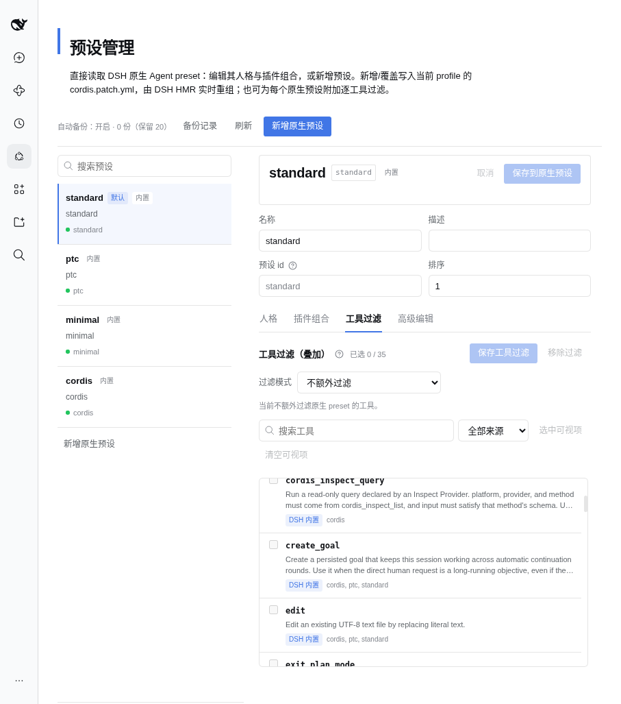

# dsh-preset-editor

把 **DeepSeek Harness（DSH）原生 Agent preset** 变成可直接编辑的可视化对象：在同一份 roster 中查看 `standard`、`ptc`、`minimal`、`cordis` 以及自定义 preset，编辑它们的人格与插件组合，新增原生 preset，并可为每个原生 preset 附加逐工具过滤与系统提示词段过滤，查看最终组成预览。

- **不再维护一套平行预设列表**：列表直接来自 `ctx.agentPresets`，与官方 Agent preset 选择器、Session header、`/permission` 等原生机制共用同一身份。
- **编辑/新增写入 profile patch**：托管块写入 `cordis.patch.yml`，由 DSH HMR 实时重组；无 HMR 的部署返回“需重启”。
- **逐工具过滤是叠加层**：用 `tools.guard` 执行拦截、`tools.restrict` 收窄可见性，不改变原生插件组合。
- **提示词段过滤也是叠加层**：用 `system-prompt/assemble` waterfall 移除指定 section，只影响模型看到的 system prompt，不改变工具权限。
- **组成预览是只读快照**：查看每个 preset 的 sections、静态 contexts、variables 与 tool declarations；不伪造真实会话历史。
- **不修改 DSH 核心**：公开 `agentPresets`、`profileContext`、`loader`、`connection.fetch`、slot 等接口。



---

## 1. 当前状态

| 能力 | 状态 | 说明 |
|---|---|---|
| 列出原生 Agent preset | ✅ | `standard` / `ptc` / `minimal` / `cordis` / 自定义 |
| 查看/编辑人格与完整插件组合 | ✅ | 结构化行 + YAML 源码；保存为 profile patch 覆盖 |
| 新增原生 preset | ✅ | 以现有 preset 为模板或空组合；写入 `insert` 声明 |
| 恢复内置定义 / 删除自定义 | ✅ | 移除本地覆盖或新增声明 |
| 逐工具过滤叠加 | ✅ | 允许 / 排除 / 不额外过滤；实际执行验证 |
| 提示词段过滤叠加 | ✅ | all / allow / deny；真实 Harness 自动化验证，真实 Web UI 待截图验收 |
| 预设组成预览 | ✅ | 静态 sections / contexts / variables / tools；真实 profile API 验证，UI 待浏览器截图 |
| HMR 实时重组 | ✅ | patch 写入后等待 roster 更新；超时回滚 |
| 无 HMR 部署 | ✅ | 返回 `restart-required`，不伪装成立即生效 |
| 真实 Web UI | ✅ | 左侧「预设管理」；真实实例已截图验收 |
| 测试 | ✅ | 83 个测试（含真实 Harness prompt/tool/preview 覆盖） |

已验证 DSH：`@deepseek-ai/dsh@0.2.2-rc.1`，Node `24.x`。

---

## 2. 安装

```bash
cd /path/to/dsh-preset-editor
npm install --omit=dev     # 安装唯一运行时依赖 js-yaml
./scripts/install.sh web
```

等价的本地 link 安装：

```bash
dsh plugin --profile web add link:/path/to/dsh-preset-editor
```

npm 安装（发布后）：

```bash
dsh plugin --profile web add dsh-preset-editor
```

重启 profile（或等待 HMR）：

```bash
dsh --profile web
```

打开 **左侧「预设管理」**。官方 **Settings → Agent presets** 仍然负责新会话默认与当前会话选择；本插件负责**编辑与新增声明**。

### 卸载

```bash
./scripts/uninstall.sh web
```

状态保留在 `$DSH_HOME/preset-editor/native.json`；需要清理时手动删除该目录。profile patch 中的托管块可先通过 UI“恢复内置定义/删除自定义”清掉，或手动删除 `# >>> dsh-preset-editor managed presets` 到 `# <<<` 的块。

---

## 3. 配置

```yaml
- id: preset-editor
  name: dsh-preset-editor
  config:
    stateFile: ''              # 默认 $DSH_HOME/preset-editor/state.json；native.json 与其同目录
    diagnostics: false         # 验收探针，默认关闭
    refreshDebounceMs: 250
    maxPresets: 100
    maxPersonaChars: 20000
    maxSessionAssignments: 5000
    backup: true               # 每次写 profile patch / native.json 前自动备份
    backupDir: ''              # 默认 $DSH_HOME/preset-editor/backups
    backupKeep: 20             # 保留最近 N 份
```

profile 的 `cordis.patch.yml` 对相同 id 的配置是整行替换，覆盖时写全字段。

### 3.1 启动修复

- 新增 preset 始终以 `- insert:` 声明写入，不会因为 HMR 后进入 roster 而退化为 direct row。
- 启动时 `repairOrphans()` 会检查托管定义是否还有 Loader declaration；缺失的 custom 定义会改写为 insert。
- 若修复失败，页面列表显示“未加载”，身份牌提供“修复为新增声明”，也可删除后重建。

### 3.2 自动备份策略

- 默认开启，用户无感知：每次写 profile patch 前保存旧 patch，每次写 `native.json` 前保存旧状态。
- 文件：`backups/patch-<ISO>-g<generation>.yml`、`backups/native-<ISO>-g<generation>.json`。
- 保留最近 `backupKeep` 份（默认 20），按修改时间裁剪。
- 页面头部显示“自动备份：开启 · N 份（保留 N）”；点击“备份记录”查看快照（一次操作产生的 patch/native 合并为一条，按系统时间命名），并可点击“回滚”。
- 备份弹窗可开关自动备份并调整保留份数（1–500），调整后立即按完整快照裁剪。
- 备份记录弹窗内可直接关闭/开启自动备份；关闭后停止生成新备份，已有备份保留。profile 配置 `backup: false` 是硬关闭，UI 不能重新开启。
- 备份时间按当前系统时区显示；大小使用 B / KB / MB，不显示原始字节数。
- 回滚会先备份当前版本，再按 native → patch 顺序恢复所选快照；恢复 patch 时同步托管定义，恢复 native 时重建 patch 托管块，避免两边不一致。
- API：`GET /api/preset-editor/native/backups`。

---

## 4. 使用

### 4.1 列表

页面采用三栏工作台：左侧预设脊柱、中央编辑器、右侧当前状态/组合/备份概览；≤1380px 收起状态轨，编辑区按剩余视口高度滚动，不出现 tab 内双滚动条。主操作使用实心钴蓝，次级操作为无边框文本按钮；未保存切换使用页面内确认，不弹浏览器原生 confirm。

左侧直接显示原生 roster。徽标说明：

- `默认`：当前新会话默认 preset（来自 `agentPresets.defaultId`）。
- `内置`：shipped preset（如 standard）。
- `已覆盖`：本插件在 profile patch 中覆盖了它。
- `自定义`：本插件新增的 preset。
- `损坏`：`agentPresets` 报 broken；此时保存被禁用。

### 4.2 编辑人格

“人格” tab 找到组合中的 `@deepseek-ai/dsh-persona` 行，编辑其 `prefix`、`complete`、`includeRuntimeContext`。保存会重写该 preset 的**完整组合**到 profile patch。

- 若没有 persona 行，可点击“添加人格插件行”。
- **新会话**使用新 revision。
- **Host 未驻留的旧会话**重新打开时，按记录的 preset id 挂载当前定义，因此会使用新组合。
- **已打开或仍驻留内存的旧会话（包括空闲）**保留旧 revision；UI 切走不等于释放 Host Agent，需释放 Agent 或重启 DSH 后重新打开。
- 人格文本中的 `{{model}}` 仍是 DSH 原生模板，按 DSH 规则替换；本插件不额外解析。

### 4.3 编辑插件组合



“插件组合” tab 显示该 preset 的全部 Cordis 插件行（group 行也会出现）。可启用/停用普通行；`!!js` 条件行只能通过高级编辑修改。

“高级编辑” tab 提供完整 entry-list YAML：

- **YAML 源码**：支持 `!!js`；保存时优先使用 YAML。
- 两个按钮是**保存来源选择器**，不是格式转换器：
  - “以结构化行改动为准”：保存时使用插件组合 tab 的行开关/插件列表，YAML 文本不参与保存；
  - “以 YAML 为准”：保存时使用 YAML 文本，结构化行不参与保存；
  - 在 YAML 编辑区输入会自动切到 YAML 来源；来源徽标会显示当前选择；
  - 切换来源不会自动把一侧内容转换到另一侧。
- YAML 编辑区独立占满 tab，并保留内部滚动，不再挤在插件组合列表底部。



### 4.4 新增原生 preset

点击“新增原生预设”：

- id：唯一，作为 `config.id` 与 Session header 身份，创建后不可改。新建 id 仅允许小写字母、数字和 `-`；已有 legacy id 仍可编辑。编辑页字段旁有 `?` 图标，悬浮/点击显示说明气泡；气泡使用 fixed 定位并自动夹在视口内，不会被编辑区 overflow 截断。
- 从现有 preset 复制组合（推荐从 `standard` 开始）或空组合。
- 保存会向 profile patch 的托管块追加 `- insert:` 声明；DSH 原生 roster 立即出现该 preset。

### 4.5 恢复内置 / 删除自定义

- 内置 preset 的“恢复内置定义”：删除本插件覆盖行，恢复 shipped 定义。
- 自定义 preset 的“删除自定义预设”：删除 `insert` 声明。
- 操作会改写 profile patch；新会话使用新组合；Host 未驻留的旧会话重新打开时使用当前定义；已打开/驻留 Agent（含空闲）保留旧 revision。

### 4.6 工具过滤（叠加）



每个原生 preset 可独立配置：

| 模式 | 行为 |
|---|---|
| 不额外过滤 | 保持原生组合 |
| 仅允许选中的工具 | 未勾选工具从模型 schema 移除，并在执行时拒绝 |
| 允许全部，但排除选中的工具 | 勾选工具隐藏并拒绝；新工具默认允许 |

- 执行拦截：`agent.ctx.tools.guard`，模型收到 `Error: 原生预设「X」的工具过滤不允许调用「Y」`。
- 可见性：`agent.ctx.tools.restrict`。
- `run_code`（PTC 传输）始终放行，内层真实调用仍检查。
- 过滤按 **原生 preset id** 绑定；任何使用该 preset 的会话共享同一过滤。
- 过滤页顶部（说明、保存/移除、模式、搜索工具栏）固定；滚动条只出现在工具列表内部，不再出现在 tab 外层。

### 4.7 提示词段过滤（叠加）

每个原生 preset 还可以独立配置 system prompt section 过滤：

| 模式 | 行为 |
|---|---|
| 不额外过滤 | 保持当前 prompt section 集合 |
| 仅保留选中的提示词段 | 未勾选 section 从最终 assembly 中移除 |
| 允许全部，但排除选中的提示词段 | 勾选 section 被移除；新 section 默认保留 |

- 适用场景：插件在全局 prompt scope 注册了静态提示词，但 preset 只过滤了它的工具。例如 `dsh-expression`（meme）在 `send_meme` 工具被关闭后，仍通过 `system-prompt/assemble` 追加 `dsh-expression:companion` 斗图规则；现在可按 preset 移除该段。
- 过滤实现：运行时注册一个 `system-prompt/assemble` waterfall 监听器，`prepend + global`，在 `next()` 返回后过滤最终 `sections`。这与工具的 `guard/restrict` 不同，只影响模型可见文本，不改变工具权限、插件组合或执行行为。
- 目录来源：`buildPromptCatalog()` 通过 `agentPresets.acquireScope()` + `systemPrompt.assemble({ scope })` 读取 global、preset 与 assembly listener 追加的 section。
- 受保护 section：`harness:identity`、`deployment:persona-prefix`、`deployment:persona-suffix` 始终保留，不能被过滤移除。
- `complete: true` 人格：DSH 会把 complete section 作为唯一 system prompt，其他 section 本来就会被抑制；UI 会提示此时 prompt 过滤不生效。
- 过滤按 **原生 preset id** 绑定；同一 preset 的所有 Agent 共享同一配置，其他 preset 不受影响。
- 提示词段过滤不是权限边界：隐藏提示词不等于禁用插件或工具；需要执行拦截时仍应使用工具过滤。

### 4.8 组成预览（预设静态快照）

每个原生 preset 新增「组成预览」tab，用来查看该 preset **组装给模型的内容**，但明确不包含真实会话历史。

展示：

- `sections`：按 assembly 顺序列出 section 名称、来源、protected / filtered 状态、字符数与截断预览；
- `renderedPreview`：最终 system prompt 的预览，可展开完整文本；
- `contexts`：预注册的 runtime context；空 context 会显示为空；
- `variables`：当前 assembly 的插值变量；
- `tools`：preset scope 的 tool declarations、来源、参数数量、overlay 决策；
- `capabilities`：插件行数、启用行数、MCP 工具数。

UI 采用单列 manifest：sections / contexts 按 assembly 顺序编号，状态用 badge 表达；只有 tab body 一个滚动容器。完整 prompt、section、context 和 tool schema 都在原位内联展开，不再嵌套滚动小窗。移动端（≤980px）列表与编辑器改为单列堆叠，tab bar 换行，filter/prompt 列表取消内部滚动，避免横向裁切。

Preview API：

```text
GET /api/preset-editor/native/preview?id=standard
GET /api/preset-editor/native/preview?id=standard&part=prompt
GET /api/preset-editor/native/preview?id=standard&part=section&name=harness:identity
GET /api/preset-editor/native/preview?id=standard&part=context&name=sandbox:policy
GET /api/preset-editor/native/preview?id=standard&part=tool&name=read
```

语义边界：

- **不做真实会话快照**：没有 Agent/session 时，`working-directory:current`、`sandbox:policy`、`approval:policy` 等 context 为空，UI 会提示；
- `{{model}}` 等会话变量在静态预览中无法插值，会列为 `unresolvedVariables` 并提示；
- 工具 overlay 在预览中模拟：denied 且可被 `restrict` 的工具标为 `hidden`，其余标为 `visible`；preset scope 自己的工具在 Agent scope 中通常可被 restrict；
- `warnings` 只放会影响判断的问题（未解析变量、complete 人格、组装失败等）；静态快照的边界说明放在 `notes`，避免和真正的问题混在一起；
- 预览是只读的，不会调用工具、不会写 preset 或 overlay；
- 默认只返回截断预览；全文和完整 tool schema 通过上面 `part=` 请求按需加载，单条上限 200,000 字符。

---

## 5. 实现机制（关键依据）

| 能力 | 接口 | 说明 |
|---|---|---|
| 列出/读取原生 preset | `ctx.agentPresets.list()` / `readDocument(id)` | 与官方 UI 完全同一 roster；YAML 使用 `entryListSchema`（JSON_SCHEMA + `!!js`）解析 |
| 查找声明行 | `ctx.loader.entries()` 的 `options.name === '@deepseek-ai/dsh-agent-preset' && config.id` | 得到 patch 目标 rowId |
| 编辑/新增 | `ctx.profileContext.patchPath` + 原子写 profile patch | 托管块：内置覆盖用直接行，新增用 `- insert:` |
| 实时生效 | DSH HMR 监听 `cordis.patch.yml` 并重组 | 写入后轮询 `agentPresets.list()` 验证；失败回滚 |
| 每 Agent 工具过滤 | `agent.ctx.tools.guard/restrict` | Agent 创建/`agent-preset/selected` 时绑定原生 preset id |
| 每 Agent 提示词段过滤 | `system-prompt/assemble` waterfall（`prepend + global`） | 在 `next()` 后过滤最终 `sections`；用 `context.agent` 定位 native preset |
| Prompt section 目录 | `agentPresets.acquireScope()` + `systemPrompt.assemble({ scope })` | 包含 global、preset 与 assembly listener 追加的 section |
| 组成预览 | `systemPrompt.assemble({ scope })` 的 `sections/contexts/variables/tools` | 预设 scope 静态快照；不伪造 Agent 级 runtime context |
| 管理 API | `ctx.connection.fetch.register` | 认证、Host/Origin、owner Peer 在 handler 前执行；同路径只注册一次 |
| UI | `ctx.slots` + primitives | 左侧「预设管理」；无平行选择器/胶囊 |

### 5.1 托管块格式

```yaml
# >>> dsh-preset-editor managed presets — do not edit this block manually
- id: preset-standard                    # 覆盖内置：直接行
  name: '@deepseek-ai/dsh-agent-preset'
  config:
    id: standard
    name: Standard X
    order: 1
    plugins: [ ... ]
- insert:                                # 新增：insert
    - id: preset-my-preset
      name: '@deepseek-ai/dsh-agent-preset'
      config:
        id: my-preset
        name: My Preset
        order: 9
        plugins: [ ... ]
# <<< dsh-preset-editor managed presets
```

其他 profile patch 行会保留；托管块只由本插件重写。

---

## 6. 管理 API

所有路由经 `ctx.connection.fetch`（owner-only），写操作需要：

```
content-type: application/json
x-dsh-preset-action: 1
```

| Method | Path | 用途 |
|---|---|---|
| GET | `/api/preset-editor/native?catalog=1` | 原生 roster + 每个组合 + 工具目录 + 提示词段目录 + overlays + backup 状态 |
| GET | `/api/preset-editor/native/backups` | 自动备份记录 |
| POST | `/api/preset-editor/native/backups/restore` | 回滚到指定快照（`{ names }`） |
| PUT | `/api/preset-editor/native/backups/policy` | 开关自动备份 / 调整保留份数（`{ enabled?, keep? }`） |
| POST/PUT/DELETE | `/api/preset-editor/native` | 新建 / 覆盖 / 恢复或删除 |
| PUT/DELETE | `/api/preset-editor/native/overlay` | 设置 / 移除工具与提示词段过滤 |
| GET | `/api/preset-editor/native/preview?id=...` | 预设组成预览；`part=` 取全文/section/context/tool schema |

请求/响应示例：

```json
// PUT /native
{
  "id": "standard",
  "name": "Standard X",
  "description": "My standard",
  "order": 1,
  "plugins": [ { "id": "persona", "name": "@deepseek-ai/dsh-persona", "config": { "prefix": "..." } } ],
  "generation": 3
}
```

`plugins` 或 `pluginsYaml` 二选一；服务端用 DSH 的 `entryListSchema` 校验/序列化。

```json
// PUT /native/overlay
{
  "id": "standard",
  "enabled": true,
  "tools": { "mode": "deny", "allow": [], "deny": ["send_meme"] },
  "prompts": { "mode": "deny", "allow": [], "deny": ["dsh-expression:companion"] },
  "generation": 3
}
```

`tools` 与 `prompts` 可分别省略；省略的一侧保留已有配置。旧客户端只发送 `tools` 时，`prompts` 不会被清空。

`generation` 是并发提示，不是写入门槛：UI 会在每次写前同步最新 generation，服务端对过期提示只记录 warning，不会因为无关的 overlay/备份写入而拒绝本次原生 preset 编辑。

---

## 7. 数据与恢复

- `$DSH_HOME/preset-editor/native.json`：托管定义 + 工具 / 提示词段 overlays；模式 `0600`，原子写。
- profile `cordis.patch.yml`：托管块；是 DSH 真正加载的来源。
- 若 `native.json` 丢失但 patch 托管块仍在，插件启动时会从 patch 恢复定义。
- 若 patch 被手动清空但 `native.json` 仍存在，UI 会显示 managed 但实际未加载；保存/重置可重新生成托管块。
- 修改前备份 `native.json` 和 `cordis.patch.yml`。

---

## 8. 测试

```bash
npm test
# 真实 Harness 集成用例需要 DSH 包路径；未设置时相关用例会 skip：
DSH_PACKAGES=/path/to/@deepseek-ai npm test
# 本机示例：
# DSH_PACKAGES=/home/astral/.nvm/versions/node/v24.22.3/lib/node_modules/@deepseek-ai/dsh/node_modules/@deepseek-ai npm test
```

覆盖：

- `test/native.test.js`：`!!js` YAML round-trip、托管块合并/替换/恢复、结构校验、NativeStore 持久化、patch 写入、reset、stale 容错、orphan 修复、insert mode 保持与备份回滚；
- `test/runtime.integration.test.js`：真实 Harness 工具可见性/guard 执行（旧 overlay 引擎，仍是核心机制回归）；
- `test/prompt-runtime.test.js`：真实 Harness 中验证 global listener 追加的 section 可按 preset 过滤、protected section 保留、不同 Agent 隔离；
- `test/catalog.test.js`：`buildPromptCatalog` 合并 global / preset / listener 追加的 section；
- `test/preview.test.js`：组成预览的 sections / contexts / variables / tools、overlay 模拟、按需 part；
- `test/schema/store/manager/http/catalog`：旧 overlay 引擎与存储/API 回归；
- `test/fixtures/e2e-agent`：真实 profile 中挂载 `standard` 原生 preset，设置/清除工具过滤并执行探针。

真实实例验收见 [docs/ACCEPTANCE.md](docs/ACCEPTANCE.md)。

---

## 9. 兼容性与限制

- 已验证 `@deepseek-ai/dsh@0.2.2-rc.1`；声明 `>=0.2.2-rc.1 <0.3.0-0`。
- **profile patch 写入依赖 DSH HMR 实时重组**；无 HMR 时返回 `restart-required`，重启后生效。若该 preset 正被运行中的 Agent 使用，DSH 可能保持旧 revision，插件会返回 `restart-required`（patch/state 已保存），重启后应用。
- 原生 preset 的组合是**插件级**；逐工具过滤与提示词段过滤都是叠加层，不改变原生组合。
- 提示词段过滤只处理 `assembly.sections`，不处理 `assembly.contexts`（工作目录、沙箱、审批等运行时上下文）；后者由 DSH 与 `dsh-persona` 的 `includeRuntimeContext` 管理。
- 组成预览是**预设级静态快照**，不包含会话历史、附件、工具结果、当前模型与 Agent 级 runtime context；需要这些内容时应看真实会话日志/轨迹，而不是把预览当作完整请求。
- 组成预览中的工具可见性是静态模拟：只反映 preset scope 的声明；Agent scope 额外注册的工具、实际 `toolSet` 准入与模型调用结果不在快照内。
- DSH 的 `PromptSection` 没有 owner 元数据；目录中的来源只能按名称前缀推断，section 名称随插件升级变化时可能失效，UI 以名称为准。
- `complete: true` 人格会让 DSH 在 waterfall 后恢复 complete section 为唯一 prompt；此时提示词段过滤不生效。
- `readDocument` 只给组合 YAML，不给声明行 id；本插件通过 `ctx.loader.entries()` 查找 rowId。若上游改变 Loader 表示，需适配。
- 自定义 preset 由本插件托管块创建；若用户也在别处写同 id 行，可能冲突，托管块按最后写入优先。
- 原生 preset 选择仍由 DSH 官方 UI/`/permission`/默认设置负责；本插件不另设选择器。
- 工作区/Session 级原生选择未在本插件中扩展（DSH 未公开对应 API）；本插件的工具过滤按 preset id 共享。
- 修改 profile patch 会影响整个 profile；只应在受信环境使用，操作前备份。
- Web UI 需要 `dsh-client-modules`/primitives；headless 仍可 host 侧使用服务与 API。

---

## 10. 目录

```
lib/index.js          Host 入口（原生 preset 版）
lib/native.js         native roster 读取、YAML、managed patch、overlays
lib/native-runtime.js 每 Agent 工具过滤 guard/restrict + 提示词段过滤
lib/native-http.js    原生 preset 管理 API（含 preview）
lib/client.js         左侧「预设管理」 UI（含组成预览）
lib/preview.js        预设组成预览 builder
lib/store.js          旧 overlay 存储（回归测试仍使用）
lib/manager.js        旧 overlay 域（回归测试仍使用）
lib/runtime.js        旧 overlay runtime（回归测试仍使用）
lib/http.js           旧 overlay HTTP（回归测试仍使用）
test/                 自动化测试与 e2e fixture
docs/                 需求、验收、截图
examples/             示例
```

## 11. 许可证

MIT。
