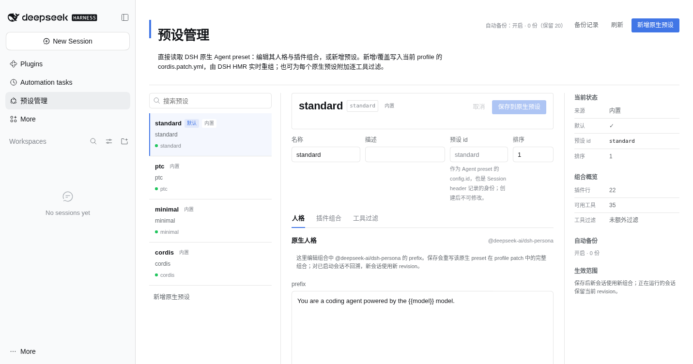
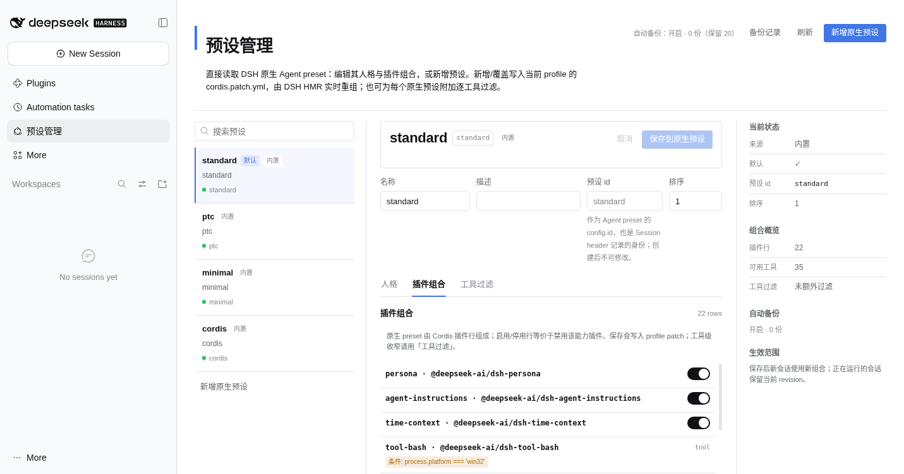
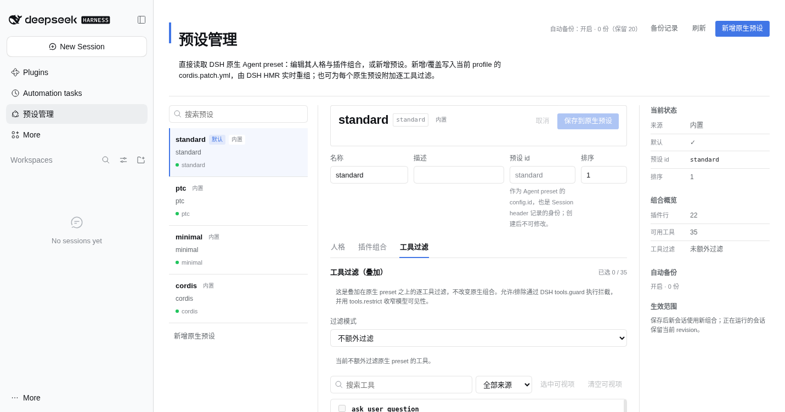

# DSH 预设管理插件 — 需求文档（原生 Agent preset 融合版）

> 项目：`dsh-preset-editor`
> 目标版本：DeepSeek Harness `0.2.2-rc.1`
> 状态：已按用户反馈从“独立预设模式”重构为“原生 Agent preset 编辑/新增 + 逐工具过滤叠加”
> 最后更新：2026-11-14

---

## 1. 背景及目标

DSH 的 Agent 能力由**原生 Agent preset** 组合：一个 preset 是一份 Cordis YAML 声明，包含人格、工具插件、技能、压缩、委派等行。官方 Web UI 能选择 preset、只读查看组合，但**不能编辑或新增**：新增/覆盖必须写 profile bundle patch，或走 Creator 对话流程。

用户明确要求：

> 与系统自带的预设融合，编辑和增加系统自带的预设，而不是单独的一个预设模式。

因此本插件的目标改为：

1. **原生融合**：列表、身份、生命周期都来自 `ctx.agentPresets`，不建立平行预设列表。
2. **可编辑**：查看并修改内置/自定义 preset 的人格与完整插件组合；保存为 profile patch 覆盖，经 DSH HMR 实时重组。
3. **可新增**：在原生 roster 中新增 preset（`insert` 声明），官方选择器立即可见。
4. **可恢复/删除**：内置可恢复官方定义；自定义可删除声明。
5. **可选逐工具过滤**：在不改变原生组合的前提下，为每个原生 preset 附加 allow/deny 工具过滤，使用 DSH 原生 `tools.guard` / `tools.restrict` 实际生效。
6. **不修改 DSH 核心**，使用公开接口；文档明确所有技术限制。

### 非目标

- 不替代官方 Agent preset 选择器/默认设置/`/permission`。
- 不实现平行“插件自建预设”模式。
- 不增加原生组合中不存在的工具；只允许**额外收窄**。
- 不修改 DSH 核心文件或 node_modules 中的 shipped bundle。

---

## 2. 用户场景

### S1 编辑标准预设的人格

左侧「预设管理」 → 选中 `standard` → 人格 tab 修改 `@deepseek-ai/dsh-persona` 的 `prefix` → 保存。profile patch 出现托管覆盖；官方 Agent preset 卡片与 Session header 的名称/人格更新（HMR 实时）。

### S2 为内置预设增删能力插件

选中 `standard` → 插件组合 tab 停用 `tool-bash` 行；或切到高级编辑 tab 编辑 YAML 去掉某一整组。保存后新会话使用当前组合；Host 未驻留的旧会话重新打开时使用当前组合；已打开/驻留 Agent（含空闲）保留旧 revision。

### S3 新增一套原生 preset

新建 → id `readonly`、名称“只读助手”、从 `standard` 复制组合 → 删除 write/edit/bash 行、保留 read/glob/grep/web → 保存。官方选择器出现 `readonly`，新会话可直接选择。

### S4 逐工具过滤

为 `standard` 打开工具过滤：`允许全部，但排除 bash/edit/write`。使用 standard 的会话在执行路径拒绝这些工具；模型 schema 也不再显示它们。原生组合不变。

### S5 恢复内置

对 `standard` 选择“恢复内置定义”，托管覆盖被删除，官方定义恢复。

---

## 3. 功能需求

| ID | 需求 | 优先级 | 验收标准 |
|---|---|---|---|
| NP-01 | 列出原生 roster | P0 | 与 `agentPresets.list()` 一致；含 broken 状态 |
| NP-02 | 读取单个 preset 组合 | P0 | `readDocument` YAML 可解析为结构化行，保留 `!!js` |
| NP-03 | 编辑人格 | P0 | 可改 `@deepseek-ai/dsh-persona` 的 prefix/complete/includeRuntimeContext |
| NP-04 | 编辑插件组合 | P0 | 行级启用/停用 + YAML 源码编辑 |
| NP-05 | 保存内置覆盖 | P0 | 写 profile patch 直接行；HMR 实时；失败回滚 |
| NP-06 | 新增原生 preset | P0 | 写 `- insert:` 声明；roster 出现；id 唯一 |
| NP-07 | 恢复内置定义 | P0 | 删除覆盖行；原 name/组合恢复 |
| NP-08 | 删除自定义 preset | P0 | 删除 insert 行；roster 消失 |
| NP-09 | 工具过滤叠加 | P0 | 三种模式；`guard` 执行拒绝 + `restrict` 可见性 |
| NP-10 | 过滤按原生 id 绑定 | P0 | 所有使用该 preset 的会话共享过滤 |
| NP-11 | 结构化/YAML 双编辑 | P1 | 保存来源二选一；来源徽标/按钮 active 状态；YAML 编辑自动选中 YAML |
| NP-12 | 托管块与用户 patch 共存 | P0 | 只改 markers 内块；其他行保留 |
| NP-13 | 状态恢复 | P1 | native.json 丢失时从 patch 托管块恢复 |
| NP-14 | HMR/无 HMR 行为 | P0 | 有 HMR 实时验证；无 HMR 返回需重启 |
| NP-15 | 错误与回滚 | P0 | 写失败/激活失败回滚 patch 与 state |
| NP-16 | 并发写 | P1 | UI 写前同步 generation；过期提示只 warning，不阻塞原生写入 |
| NP-17 | 浏览器 UI | P0 | 左侧「预设管理」；列表/编辑/新增/恢复/过滤；半屏单滚动容器；过滤顶栏固定 |
| NP-18 | 会话/身份一致性 | P0 | 原生 id 是 config.id 与 Session header 身份；无平行 id |
| NP-19 | 空/加载/损坏/错误状态 | P1 | 明确 UI |
| NP-20 | 管理 API 安全 | P0 | owner-only + CSRF header + body limit |
| NP-21 | 测试与真实实例验收 | P0 | 自动测试 + 真实 DSH profile/Chrome |
| NP-23 | 备份回滚 | P1 | 备份记录可回滚；回滚前自动备份当前版本；patch/native 一致性修复 |
| NP-22 | 无核心修改 | P0 | 仅 profile patch/公开服务 |

---

## 4. 数据结构

### 4.1 `$DSH_HOME/preset-manager/native.json`

```json
{
  "version": 1,
  "generation": 4,
  "definitions": {
    "standard": {
      "configId": "standard",
      "rowId": "preset-standard",
      "mode": "override",
      "name": "Standard X",
      "description": "自定义标准",
      "order": 1,
      "baseName": "standard",
      "baseDescription": "",
      "baseOrder": 1,
      "plugins": [ { "id": "persona", "name": "@deepseek-ai/dsh-persona", "config": { "prefix": "..." } } ],
      "updatedAt": "..."
    },
    "readonly": {
      "configId": "readonly",
      "rowId": "preset-readonly",
      "mode": "create",
      "name": "只读助手",
      "description": "",
      "order": 9,
      "plugins": [ ... ],
      "updatedAt": "..."
    }
  },
  "overlays": {
    "standard": {
      "tools": { "mode": "deny", "allow": [], "deny": ["bash", "write", "edit"] },
      "enabled": true,
      "updatedAt": "..."
    }
  },
  "updatedAt": 1794666000000
}
```

- `mode=override`：覆盖已有声明；`rowId` 来自 `ctx.loader.entries()`。
- `mode=create`：新增声明；`rowId=preset-<id>`，写入 `- insert:`。
- `plugins`：解析后的 Cordis entry list，`!!js` 以 `{ "__jsExpr": "..." }` 保留。
- `baseName/baseDescription/baseOrder`：覆盖前原始值，用于恢复后验证。
- `overlays`：按 native preset id 的逐工具过滤。

### 4.2 profile patch 托管块

```yaml
# >>> dsh-preset-manager managed presets — do not edit this block manually
- id: preset-standard
  name: '@deepseek-ai/dsh-agent-preset'
  config:
    id: standard
    name: Standard X
    order: 1
    plugins: [ ... ]
- insert:
    - id: preset-readonly
      name: '@deepseek-ai/dsh-agent-preset'
      config:
        id: readonly
        order: 9
        plugins: [ ... ]
# <<< dsh-preset-manager managed presets
```

- 覆盖使用**直接行**，按 Loader patch 的 id 匹配替换完整 config。
- 新增使用 `- insert:`，否则 Loader 不会创建新行（这是实际测试中发现的约束）。
- 托管块写入前先读取现有文件；只替换 markers 内内容，保留用户其他 patch 行。
- 空 patch 根 `[]`（含注释头）会被替换，避免出现第二个顶层数组。

### 4.3 自动备份策略

- 默认开启：写 profile patch 前备份旧 patch；写 `native.json` 前备份旧状态。
- 目录：`$DSH_HOME/preset-manager/backups`，可通过 `backupDir` 指定。
- 保留最近 `backupKeep` 份（默认 20），按 mtime 裁剪。
- 页面头部展示备份状态/数量；“备份记录”弹窗列出文件、系统本地时间、B/KB/MB 大小；API `GET /api/preset-manager/native/backups`。
- 备份失败只记录 warning，不阻断主写入；主写入失败时回滚 patch/state。

### 4.4 校验

- preset id：`[a-z0-9][a-z0-9._:-]{0,63}`。
- entry list：必须是数组；每项对象含非空 `name`；`group` 的 `config` 必须是子数组；`disabled` 为布尔或 `!!js`。
- YAML 使用 DSH `entryListSchema`（`JSON_SCHEMA` + `!!js`）解析/序列化。
- 名字/描述/order 长度与类型校验；body 上限。

---

## 5. 界面

### 5.1 入口

左侧快捷列表「预设管理」独立页面（官方 **Agent presets** 仍负责选择/默认）。

### 5.2 布局

```
原生 Agent 预设
├─ 顶部：刷新 / 新增原生预设
├─ 左栏：原生 roster（默认/内置/已覆盖/自定义/损坏、overlay 标记）
└─ 右栏
   ├─ 名称/描述/id（只读）/排序
   ├─ 恢复内置定义 或 删除自定义
   ├─ Tabs：人格 | 插件组合 | 工具过滤
   │  ├─ 人格：@deepseek-ai/dsh-persona prefix / complete / includeRuntimeContext
   │  ├─ 插件组合：行级启停 + YAML 源码
   │  └─ 工具过滤：模式 + 搜索/来源筛选/批量选择 + 保存/移除
   └─ 未保存徽标 / 错误横幅
```

### 5.3 交互

- 切换 preset：有未保存改动时确认。
- 保存：写 profile patch；HMR 成功后重新读取 roster；失败回滚并显示。
- 新增：模板选择（现有 preset / 空）、id/name/description/order。
- 恢复/删除：确认 modal；内置恢复原始定义，自定义删除 insert。
- 工具过滤：草稿式；单独保存；与原生组合保存互不影响。
- 空 roster/加载/损坏/API 不可用：明确提示。
- 所有图标/按钮/开关复用 primitives；无 iframe。





---

## 6. 架构与模块

```
lib/index.js          原生版入口：NativeStore/Manager/Runtime、服务、事件、API
lib/native.js         roster 读取、entryList YAML、managed patch、overlays、HMR 验证
lib/native-runtime.js 每 Agent guard/restrict，按 native preset id 读取 overlay
lib/native-http.js    /api/preset-manager/native 与 /overlay
lib/client.js         左侧「预设管理」
lib/catalog.js        工具发现/分类（复用）
lib/store.js          旧 overlay 存储（回归测试）
lib/manager.js        旧 overlay 域（回归测试）
lib/runtime.js        旧 overlay 运行时（回归测试）
lib/http.js           旧 overlay HTTP（回归测试）
lib/probe.js          诊断探针
```

原生版不实例化旧 overlay 的 `PresetManager/PresetRuntime`；旧模块仅保留给回归测试与可复用工具函数（`restrict`/`guard` 辅助）。

---

## 7. DSH 接口依据（已验证）

| 用途 | 接口 | 依据 |
|---|---|---|
| roster | `ctx.agentPresets.list()` | `AgentPreset{id,name,description,order,broken}` |
| 组合 | `ctx.agentPresets.readDocument(id)` | 返回 `content` entry-list YAML（`entryListSchema`） |
| native id | `ctx.agentPresets.composedPreset(agent.ctx)` / `presetForSession(session)` | Agent 当前原生绑定 |
| 事件 | `ctx.on('agent-preset/selected', (sessionId,id))` | blank session 切换 |
| 声明行定位 | `ctx.loader.entries()` → `options.name===... && options.config.id` | 得到 rowId |
| profile patch | `ctx.profileContext.patchPath` | 用户 patch 文件绝对路径 |
| 实时重组 | DSH HMR 监听 profile/home patch | 写入后轮询 roster |
| 工具控制 | `agent.ctx.tools.guard/restrict` | 原生执行路径 |
| HTTP | `ctx.connection.fetch.register` | owner-only exact routes |
| UI | `ctx.slots` `main` + `sidebar.panellist` | 左侧快捷列表，独立页面 |

### 7.1 已验证的运行事实

- 写入 profile patch 的 `- insert:` 可在运行中新增原生 preset；直接行可覆盖内置 preset；HMR 自动重组，无需重启。
- `readDocument` 的 YAML 可被 `js-yaml` + `entryListSchema` 无损解析/重写（`!!js` 保留）。
- 把托管块删空时必须写回 `[]`，空文件会阻塞 HMR 重组。
- 删除 insert 后，`agentPresets.list()` 会移除该 preset；删除覆盖后原 name/组合恢复。
- `agentPresets.mount(agentCtx,'standard')` 的真实 Agent 能看到 standard 的全部工具；overlay deny 后 probe/bash 从 `definitions(agent)` 消失且执行被 guard 拒绝；clear 后恢复。
- HTTP 同一 path 只能注册一次（GET/POST/PUT/DELETE 合并）；这是实际失败后修复的。

---

## 8. 工具过滤规则

- 无 overlay / `enabled=false` / `mode=all`：不干预原生组合。
- `mode=allow`：只允许配置列表；执行/可见性都收窄；列表为空 → deny all。
- `mode=deny`：排除配置列表；新工具默认允许。
- `run_code` 始终放行；内层工具按真实名字检查。
- 按 native preset id 查找 overlay；所有使用该 preset 的 Agent 共享。
- `restrict` 失败（Agent 自身作用域工具等）时 guard 仍执行拒绝；文档说明可见性可能不完整。
- 工具注册变化 `tools/change` 去抖后重算可见性。

---

## 9. 作用域与生效时机

- **选择**：完全交给 DSH 原生 `agentPresets`（官方 Settings 默认、blank session picker、`/permission` 等）。
- **编辑**：profile 级；所有使用该 profile 的会话受影响（新 revision）。运行中的 Agent 保留已绑定 revision，不回溯。
- **过滤 overlay**：profile 级、按 native id 共享。
- 没有平行的工作区/会话 preset 映射；DSH 原生层未公开 workspace→preset API，本插件不伪造。若后续需要，可在上层另行实现并明确记录。

---

## 10. 异常/安全/兼容

- 写 patch 失败或激活失败：回滚 patch 与 state；返回结构化错误。
- HMR 超时：回滚；无 HMR：返回 `restart-required`。
- generation 仅作为并发提示：UI 写前同步；过期不返回 409，避免无关写入导致保存被锁。
- body 上限、id/YAML 校验、CSRF header、owner-only、0600/0700 状态。
- 不提供任意工具执行 API；诊断探针固定工具、默认关闭。
- 修改 profile patch 是 profile-wide 操作；文档提示备份。
- 与官方 Agent preset UI 共存：同一 roster，不抢选择器。
- 不修改核心；若上游 `readDocument`/Loader 表示变化，需适配并会在日志报错。

---

## 11. 测试与验收

自动化：`npm test`（schema/store/manager/catalog/http/runtime + native YAML/store/manager）。

真实实例：
- 独立 DSH_HOME + `dsh --profile e2e --port 0 --no-open`；
- curl cookie jar 打 `/api/preset-manager/native`；
- API 写入/覆盖/新增/恢复；
- Chrome CDP 打开 左侧「预设管理」并截图；
- fixture 挂载 `standard` 原生 preset，设置/清除 overlay 并执行 probe。

详见 [ACCEPTANCE.md](ACCEPTANCE.md)。

---

## 12. 已知限制

1. profile patch 写入依赖 HMR；无 HMR 需要重启。
2. 原生 preset 组合是插件级；逐工具过滤是叠加层。
3. `readDocument` 不提供声明 rowId；依赖 `ctx.loader.entries()`，上游 Loader 表示变化需适配。
4. 不提供工作区/Session 级原生选择（DSH 无公开 API）。
5. 用户手工同 id patch 可能与托管块冲突；托管块最后写入优先。
6. 新会话使用当前定义；Host 未驻留的旧会话重新打开时也会使用当前定义；已打开/驻留 Agent 不回溯，释放 Agent 或重启后重新打开。
7. 修改 profile 会影响所有会话；需备份。
8. `complete: true` 的 persona 可能抑制自定义人格行；这是 DSH prompt 语义，UI 显示 `complete` 开关。
9. 外部 bundle 的 preset 保存会创建本地覆盖。
10. 无导入/导出/同步/审计（后续）。
